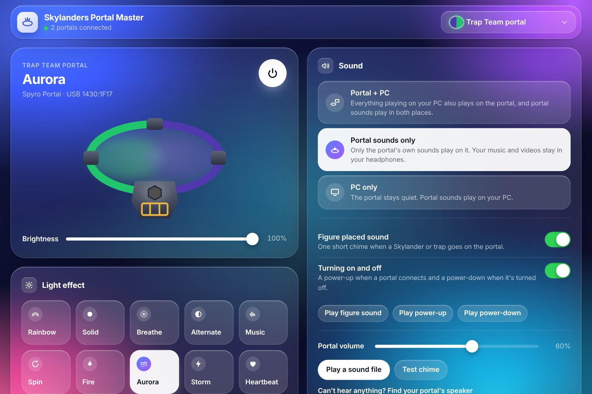
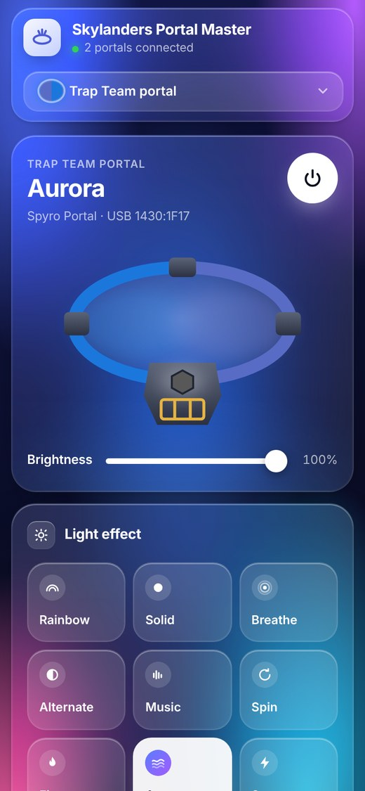

# Skylanders Portal Master

Light up your Xbox 360 Skylanders portals from your PC, no game needed. Pick colours and effects, play sounds through the Trap Team portal's speaker, and control everything from your phone.



## Features

- **Light effects.** Rainbow, Breathe, Spin, Fire, Aurora, Storm, Heartbeat, Elements, Power up, Music (reacts to whatever's playing) and more, with your own colours.
- **Both portals at once.** Spyro's Adventure / Giants and Trap Team portals, each with its own settings. Pick one from the dropdown.
- **Trap Team speaker.** Play sound files, copy your PC's sound to the portal, or just hear the portal's own chimes.
- **Figure detection.** A chime and a glow in the figure's element colour when a Skylander or trap is placed.
- **Phone remote.** Scan a QR code and control the portals from any phone on your Wi-Fi.
- **Web version.** Runs in Chrome or Edge and talks to the portal directly over USB, with nothing to install.
- **Runs quietly in the background.** Starts with Windows and lives in the tray.



## Download

Get **SkylandersPortalMaster.exe** from the [latest release](https://github.com/ZainSWE/skylanders-portal-master/releases/latest) and run it. It installs itself for your Windows user and adds a Start menu shortcut.

Windows may show a SmartScreen warning because the app isn't code-signed. Click **More info**, then **Run anyway**.

### One-time driver setup

Windows needs the WinUSB driver to talk to the portal:

1. Download [Zadig](https://zadig.akeo.ie/) and open it.
2. Choose your portal in the list (**Options > List All Devices** if it's missing).
3. Make sure **WinUSB** is selected, then click **Install Driver** (or **Replace Driver**).

Do this once for each portal. It only affects this PC, not your Xbox.

## Web version

Open **https://ZainSWE.github.io/skylanders-portal-master/** in Chrome or Edge, click **Connect portal** and choose your portal.

- Works on Windows, macOS, Linux, ChromeOS and Android (with a USB-OTG adapter). It doesn't work on iPhone or iPad, because Safari has no USB access.
- On Windows the portal still needs the WinUSB driver from Zadig.
- Close the desktop app first. Only one program can use a portal at a time.
- The Music effect and copying PC sound to the portal are only in the desktop app.

## Phone remote

In the desktop app, turn on **Phone remote** and scan the QR code with your phone. The phone must be on the same Wi-Fi. When Windows asks about the firewall, allow private networks.

The link contains a private key. Anyone on your Wi-Fi who has it can control the portals, so use **Make a new link** if you've shared it.

## Supported portals

| Portal | USB ID | Lights | Speaker |
|---|---|---|---|
| Xbox 360 Spyro's Adventure / Giants portal | 1430:1F17 | One colour | — |
| Xbox 360 Trap Team portal | 1430:1F17 | Left, right and trap slot | Yes |

## Safe for your figures

The app only ever **reads** figures. It never sends the command that writes to them, so your Skylanders' levels, gold and trapped villains can't be changed.

## Building from source

You need [Go 1.24+](https://go.dev/dl/) and Python 3.

```sh
# Windows app
GOOS=windows GOARCH=amd64 go build -trimpath -ldflags "-H windowsgui -s -w" -o SkylandersPortalMaster.exe .

# Web version (one self-contained HTML file)
GOOS=js GOARCH=wasm go build -trimpath -ldflags "-s -w" -o core.wasm .
python3 tools/build_web.py core.wasm "$(go env GOROOT)/lib/wasm/wasm_exec.js" index.html

# Try the interface on Linux or macOS with simulated portals
go run . connected 2

# Tests
go test ./...
```

On Windows PowerShell, set the variables first, for example `$env:GOOS="windows"; $env:GOARCH="amd64"`.

## Making a release

Push a version tag and GitHub Actions builds and publishes everything:

```sh
git tag v9.1.0
git push origin v9.1.0
```

The release gets `SkylandersPortalMaster.exe`, the web version as a single HTML file, and SHA-256 checksums. The web version on GitHub Pages updates on every push to `main`.

## Project layout

```
*.go                   app and engine (Windows app, web version and test demo share this code)
web/                   the interface, used by the desktop app, phone remote and web version
webapp/webusb.js       the web version's USB connection
res/                   Windows icon, manifest and version info
tools/                 build helpers for the web version and release versions
.github/workflows/     CI, releases and GitHub Pages
```

## Disclaimer

This is an unofficial fan project. It isn't affiliated with or endorsed by Activision. Skylanders is a trademark of Activision Publishing, Inc. No game assets are included.

## License

[MIT](LICENSE). Includes work from other projects, see [THIRD_PARTY_NOTICES.md](THIRD_PARTY_NOTICES.md).
